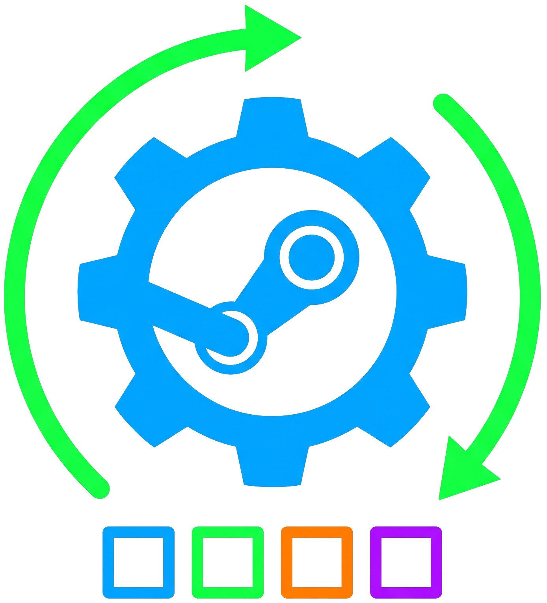
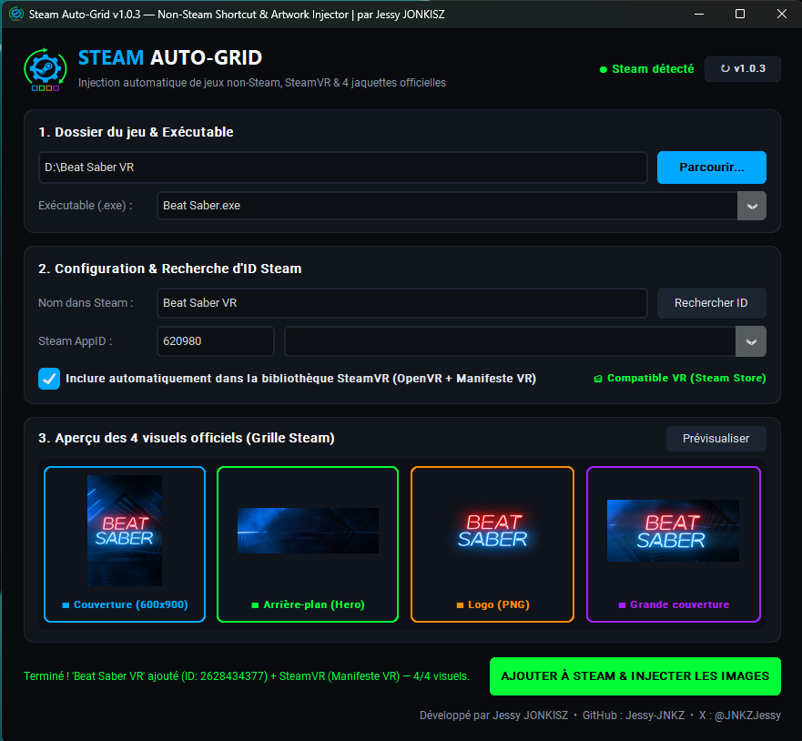

<div align="center">
  
  <h1>Steam Auto-Grid</h1>
  <p>
    <strong>Outil Windows tout-en-un pour ajouter vos jeux non-Steam, générer les manifestes SteamVR et injecter les 4 jaquettes officielles en un clic.</strong>
  </p>

  <p>
    <a href="https://github.com/Jessy-JNKZ/steam-auto-grid/releases/latest">
      
    </a>
    
    
    
  </p>

  <p>
    <strong>🇫🇷 Français</strong> • <a href="README.md">🇬🇧 Read in English</a> • <a href="https://github.com/Jessy-JNKZ/steam-auto-grid/releases">📥 Télécharger (.exe)</a>
  </p>
</div>

---

<div align="center">
  
</div>

---

## ✨ Fonctionnalités principales

- **🔍 Détection automatique de Steam :** Repère automatiquement le dossier d'installation de Steam ainsi que votre profil utilisateur actif (`userdata`) via le Registre Windows.
- **🎯 Scan intelligent du dossier du jeu :** Identifie l'exécutable principal (en filtrant les désinstalleurs et redistribuables) et détecte l'AppID Steam officiel depuis les fichiers locaux (`steam_appid.txt`, `.ini`) ou via l'API de recherche du magasin Steam.
- **🥽 Support natif de la bibliothèque SteamVR (`OpenVR`) :**
  - Détecte les bibliothèques VR (`openvr_api.dll`, `openxr_loader.dll`, `OVRPlugin.dll`, dossiers `OpenVR`/`Oculus`) et les catégories VR officielles du magasin Steam (*VR uniquement* / *VR pris en charge*).
  - Active `OpenVR = 1` dans `shortcuts.vdf`, génère les fichiers `steam.app.<id>.vrmanifest` et `.vrappconfig`, et enregistre le jeu dans `Steam\config\appconfig.json` pour qu'il apparaisse directement dans l'onglet **VR** de votre casque.
- **🖼️ Prévisualisation & injection des 4 visuels officiels :** Télécharge et affiche un aperçu en direct des 4 jaquettes avant de les injecter dans `config\grid\` :

| Code couleur | Type de visuel | Fichier généré | Format / Résolution |
| :---: | :--- | :--- | :--- |
| 🟦 **Bleu** | **Couverture (Grille)** | `<appid>p.jpg` | Affiche verticale `600x900` |
| 🟩 **Vert** | **Arrière-plan (Hero)** | `<appid>_hero.jpg` | Bannière large `1920x620` |
| 🟧 **Orange** | **Logo transparent** | `<appid>_logo.png` | Logo `PNG` détouré |
| 🟪 **Violet** | **Grande couverture** | `<appid>.jpg` | Miniature horizontale `460x215` |

- **🔄 Mise à jour automatique intégrée :** Vérifie silencieusement les Releases GitHub au démarrage (ou manuellement via le bouton en haut à droite) et met à jour `Steam-Auto-Grid.exe` automatiquement.
- **🛡️ Injection sécurisée dans `shortcuts.vdf` :** Crée une sauvegarde automatique (`shortcuts.vdf.bak`), ferme proprement Steam et SteamVR (avec élévation UAC automatique si nécessaire), évite les doublons et relance Steam automatiquement.

---

## 🚀 Utilisation (Version compilée)

1. Téléchargez **`Steam-Auto-Grid.exe`** depuis l'onglet [**Releases**](https://github.com/Jessy-JNKZ/steam-auto-grid/releases/latest).
2. Lancez l'application n'importe où (ou placez-la directement dans le dossier racine d'un jeu pour une détection immédiate).
3. Vérifiez le nom du jeu, l'AppID détecté, l'option VR et l'aperçu des 4 jaquettes.
4. Cliquez sur **`AJOUTER À STEAM & INJECTER LES IMAGES`** — Steam redémarre automatiquement avec votre jeu prêt à lancer.

---

## 🛠️ Compilation depuis les sources

Assurez-vous que **Python 3.10+** est installé sous Windows, placez `icon.png` et `icon.ico` à la racine du projet, puis lancez :

```bat
build.bat
```

`build.bat` installe automatiquement les dépendances, génère une icône Windows `.ico` multi-tailles et produit l'exécutable autonome dans `dist\Steam-Auto-Grid.exe`.

---

## 👤 Auteur

Développé par **Jessy JONKISZ**  
- GitHub : [@Jessy-JNKZ](https://github.com/Jessy-JNKZ)  
- X (Twitter) : [@JNKZJessy](https://x.com/JNKZJessy)