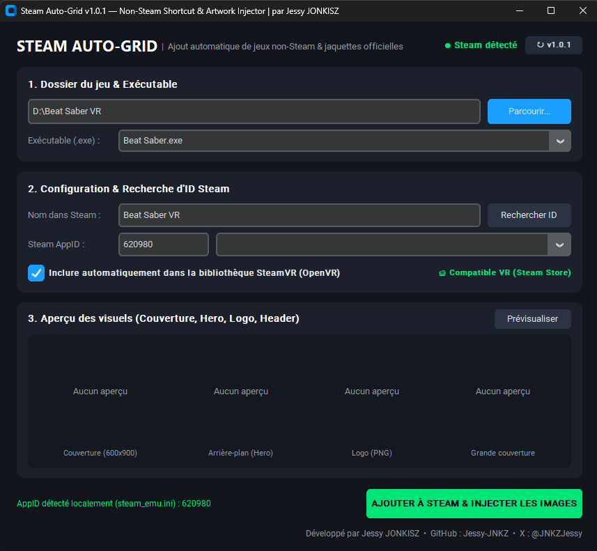

# Steam Auto-Grid

[🇫🇷 Français](#-français) • [🇬🇧 English](#-english)



---

## 🇫🇷 Français

Outil Windows léger avec interface moderne permettant d'ajouter automatiquement un jeu non-Steam à votre bibliothèque et d'injecter ses 4 visuels officiels (**Couverture 600x900**, **Bannière Hero**, **Logo transparent** et **Grande couverture Header**) en un clic.

### Fonctionnalités
- **Détection automatique de Steam** et du profil utilisateur actif via le Registre Windows.
- **Scan intelligent du dossier du jeu** : repère l'exécutable principal (en ignorant les désinstalleurs/redistribuables) et détecte automatiquement l'AppID Steam officiel via les fichiers locaux (`steam_appid.txt`, `.ini`) ou via l'API publique du magasin Steam.
- **Prévisualisation en temps réel** des 4 jaquettes avant l'injection.
- **Injection native dans `shortcuts.vdf`** avec sauvegarde de sécurité automatique (`shortcuts.vdf.bak`), fermeture forcée et relancement automatique de Steam, et prévention des doublons.

### Utilisation (Version compilée)
1. Téléchargez `Steam-Auto-Grid.exe` depuis l'onglet **Releases**.
2. Lancez l'application (ou placez-la directement dans le dossier d'un jeu pour une détection immédiate).
3. Vérifiez l'aperçu des jaquettes et cliquez sur **AJOUTER À STEAM & INJECTER LES IMAGES**.

### Compilation depuis les sources
Assurez-vous d'avoir Python 3.10+ installé, puis lancez simplement :
```bat
build.bat
