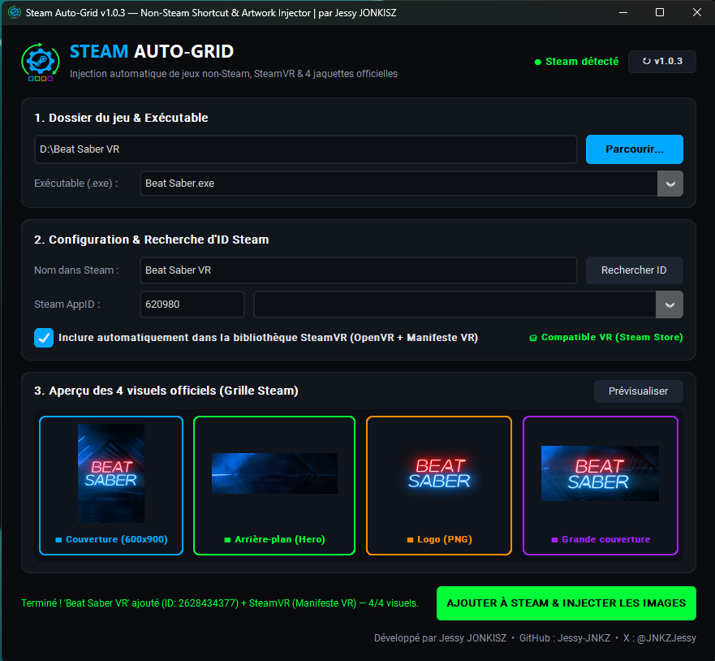

<div align="center">
  
  <h1>Steam Auto-Grid</h1>
  <p>
    <strong>One-click Non-Steam game library injector, SteamVR manifest generator &amp; official artwork downloader for Windows.</strong>
  </p>

  <p>
    <a href="https://github.com/Jessy-JNKZ/steam-auto-grid/releases/latest">
      
    </a>
    
    
    
  </p>

  <p>
    <a href="README.fr.md">🇫🇷 Lire en Français</a> • <strong>🇬🇧 English</strong> • <a href="https://github.com/Jessy-JNKZ/steam-auto-grid/releases">📥 Download (.exe)</a>
  </p>
</div>

---

<div align="center">
  
</div>

---

## ✨ Key Features

- **🔍 Automatic Steam & Profile Detection:** Locates your Steam installation path and active user account (`userdata`) directly via the Windows Registry.
- **🎯 Smart Game Folder Scanner:** Automatically identifies the main executable (filtering out uninstallers and redistributables) and detects the official Steam AppID from local files (`steam_appid.txt`, `.ini`) or via the Steam Store Search API.
- **🥽 Native SteamVR Library Integration (`OpenVR`):**
  - Detects VR runtimes (`openvr_api.dll`, `openxr_loader.dll`, `OVRPlugin.dll`, `OpenVR`/`Oculus` folders) and official Steam Store VR categories (*VR Only* / *VR Supported*).
  - Enables `OpenVR = 1` in `shortcuts.vdf`, generates `steam.app.<id>.vrmanifest` & `.vrappconfig`, and registers the app in `Steam\config\appconfig.json` so your game appears directly inside your VR headset dashboard.
- **🖼️ Live 4-Asset Grid Preview & Injection:** Fetches and previews all 4 official Steam grid artworks before injecting them into `config\grid\`:

| Color Code | Artwork Type | Target Filename | Resolution / Format |
| :---: | :--- | :--- | :--- |
| 🟦 **Blue** | **Library Cover** | `<appid>p.jpg` | `600x900` Vertical Poster |
| 🟩 **Green** | **Hero Banner** | `<appid>_hero.jpg` | `1920x620` Background Banner |
| 🟧 **Orange** | **Transparent Logo** | `<appid>_logo.png` | Transparent `PNG` Overlay |
| 🟪 **Purple** | **Header Capsule** | `<appid>.jpg` | `460x215` Recent Games Grid |

- **🔄 Built-in Auto-Updater:** Checks GitHub Releases silently at startup (or on-demand via the top bar button) and updates `Steam-Auto-Grid.exe` in-place automatically.
- **🛡️ Safe `shortcuts.vdf` Injection:** Creates an automatic `shortcuts.vdf.bak` backup, safely closes Steam & SteamVR (with automatic UAC elevation if needed), prevents duplicate entries, and relaunches Steam automatically.

---

## 🚀 Usage (Compiled Release)

1. Download **`Steam-Auto-Grid.exe`** from the [**Releases**](https://github.com/Jessy-JNKZ/steam-auto-grid/releases/latest) page.
2. Run the executable anywhere (or drop it directly into a game's root folder for instant auto-detection).
3. Verify the game name, AppID, VR toggle, and 4 artwork previews.
4. Click **`AJOUTER À STEAM & INJECTER LES IMAGES`** — Steam will restart automatically with your game and artwork ready.

---

## 🛠️ Build from Source

Make sure **Python 3.10+** is installed on Windows, place `icon.png` and `icon.ico` at the repository root, and run:

```bat
build.bat
```

`build.bat` automatically installs dependencies, generates a multi-size Windows `.ico`, and outputs the standalone executable in `dist\Steam-Auto-Grid.exe`.

---

## 👤 Author

Developed by **Jessy JONKISZ**  
- GitHub: [@Jessy-JNKZ](https://github.com/Jessy-JNKZ)  
- X (Twitter): [@JNKZJessy](https://x.com/JNKZJessy)